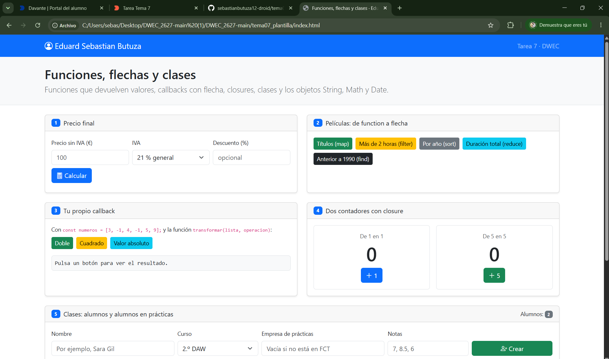
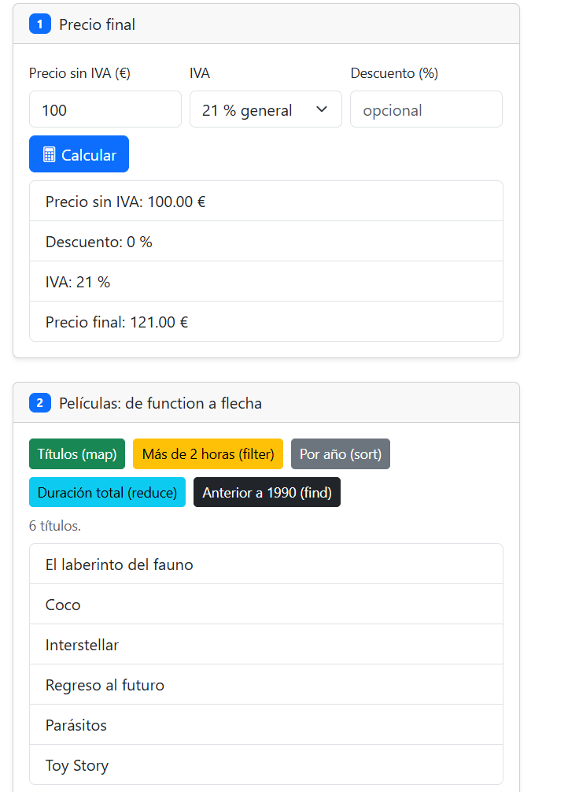
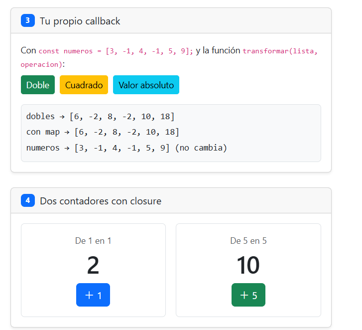
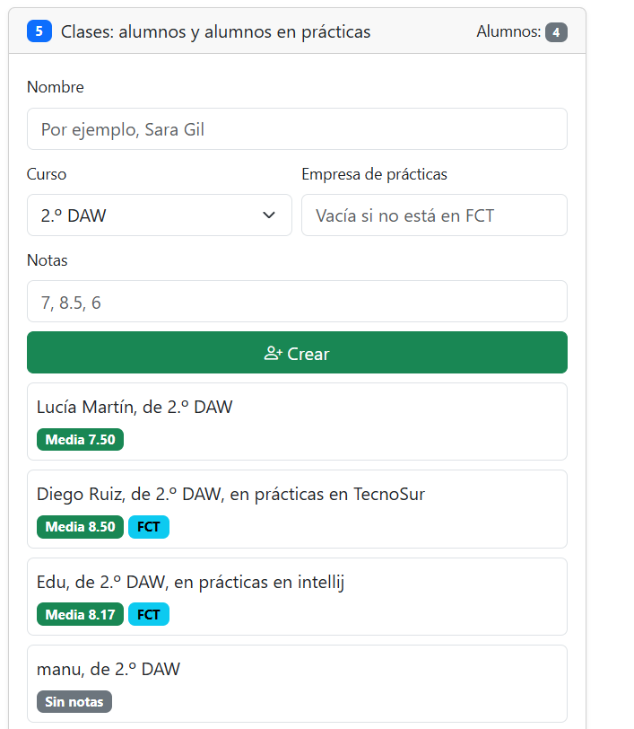
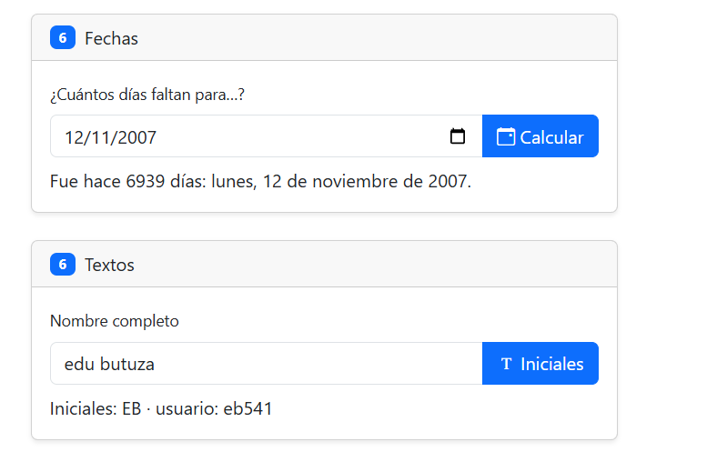

# Tarea 7 · Funciones, flechas y clases

**Autor:** Eduard Sebastian Butuza · Desarrollo Web en Entorno Cliente (DWEC) · 2.º DAW · Curso 2026-27

## Capturas

### a) La página recién cargada

Al cargar la página aparece mi nombre y se muestran los dos alumnos iniciales.

### b) Ejercicios 1 y 2: el precio y las películas

La captura muestra el desglose del precio y los títulos de las películas. `calcularPrecio()` devuelve el precio final; `mostrarPrecio()` lee los campos, valida los datos y enseña el desglose.

### c) Ejercicios 3 y 4: tu callback y los contadores

`transformar()` recorre la lista, aplica el callback a cada número y guarda los resultados en otro array. Cada contador mantiene su cuenta independiente mediante un closure.

### d) Ejercicio 5: los alumnos

Se muestran cuatro alumnos, dos de ellos en prácticas. Si se indica una empresa se crea un `AlumnoFCT`; si se deja vacío, se crea un `Alumno`.

### e) Ejercicio 6: fechas y textos

Probé la fecha 12/11/2007 y el resultado fue que había pasado hace 6939 días. Se redondea la resta porque los cambios de hora pueden hacer que la diferencia no sea un número entero de días.

## Reflexión

Al escribir un callback con una función flecha, la sintaxis queda más corta.
En este trabajo las he usado en operaciones como map, filter y reduce.
Si la flecha tiene una sola expresión, devuelve su resultado automáticamente.
Con un cuerpo entre llaves hay que usar return para devolver un valor.
Los métodos de las clases usan la sintaxis corta, por ejemplo media(), y no una flecha.
Así pueden usar this para acceder a los datos del objeto, como sus notas.

## Fuentes

- [Array.prototype.map() — MDN](https://developer.mozilla.org/es/docs/Web/JavaScript/Reference/Global_Objects/Array/map)
- [Clases — JavaScript | MDN](https://developer.mozilla.org/es/docs/Web/JavaScript/Reference/Classes)
- [Date — JavaScript | MDN](https://developer.mozilla.org/es/docs/Web/JavaScript/Reference/Global_Objects/Date)

## Uso de IA

He usado ia para ayudarme con el ejercicio 5 y 3 del js porque me daba algunos errores y no sabia terminarlo bien
